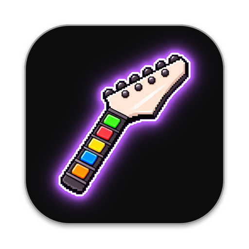
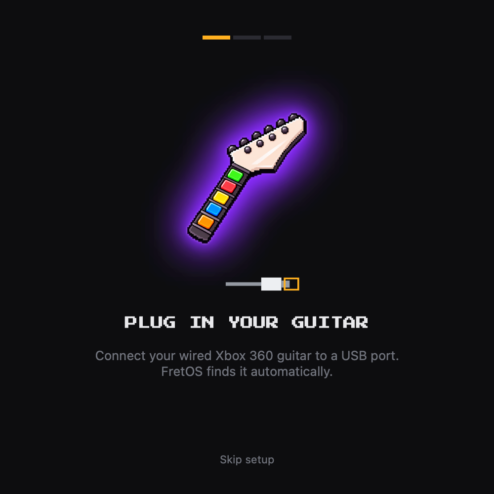
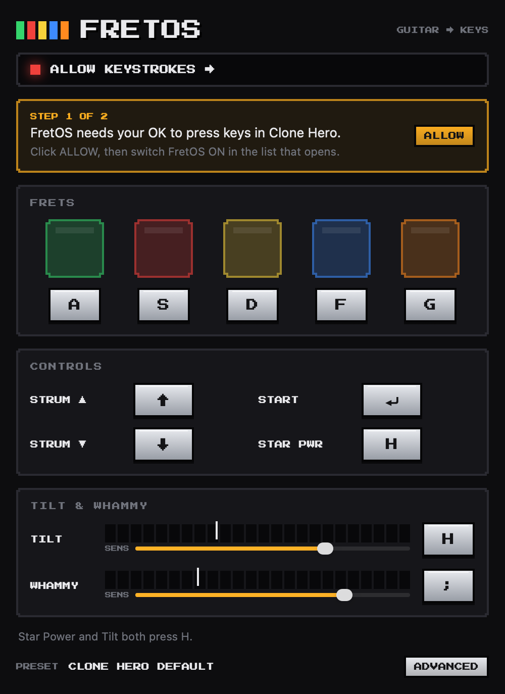
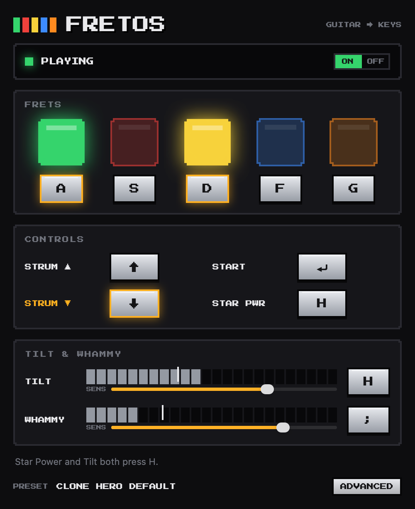

<p align="center"></p>

# FretOS

**Play Clone Hero on a Mac with a wired Xbox 360 guitar.** Works on Apple Silicon (M1, M2, M3, M4) and Intel Macs. Free. No driver, no Terminal.

<p align="center"></p>

## What it does

- Xbox 360 guitars don't work on Macs. Clone Hero can't see them, and the old 360Controller driver doesn't work on newer Macs.
- FretOS fixes that. Plug in your guitar, and FretOS turns every fret, strum, star power, tilt and whammy into keyboard keys that Clone Hero already understands.
- It's set up for Clone Hero's default controls, so you don't have to change any settings.

## What you need

- A Mac with macOS 13 (Ventura) or newer
- A **wired** Xbox 360 guitar, like the Guitar Hero X-plorer (see [Supported guitars](#supported-guitars))
- Clone Hero

---

## How to install (about 2 minutes, only once)

### Step 1. Download

Go to the **[download page](../../releases/latest)**. Under **Assets**, click **`FretOS-1.2.0.zip`** (the version number may be newer).

### Step 2. Unzip and move to Applications

Open your **Downloads** folder and double-click the zip. You get a folder with **FretOS** and a **READ ME FIRST** file.

Drag **FretOS** into your **Applications** folder.

### Step 3. Open FretOS

Double-click **FretOS**. macOS will say it **could not verify** FretOS. This is normal for free apps that aren't registered with Apple. Here's how to open it anyway:

**macOS 15 (Sequoia) or newer**
1. Click **Done**.
2. Open **System Settings** (Apple menu, top left) and click **Privacy & Security**.
3. Scroll down. Next to **"FretOS" was blocked**, click **Open Anyway**.
4. Click **Open Anyway** again and enter your Mac password.

**macOS 13 (Ventura) or 14 (Sonoma)**
1. Right-click (or Control-click) **FretOS** and choose **Open**.
2. Click **Open**.

Not sure which macOS you have? Apple menu > **About This Mac**.

### Step 4. Plug in your guitar

Plug the guitar into a USB port (use an adapter if your Mac only has USB-C). FretOS finds it by itself and moves on.

<p align="center"></p>

### Step 5. Let FretOS press keys

macOS needs your OK before any app can press keys for you.

1. Click the **yellow button** in FretOS (it says **OPEN SETTINGS** or **ALLOW**).
2. System Settings opens to **Privacy & Security > Accessibility**. Turn on the switch next to **FretOS**. Enter your password if asked.
3. Go back to FretOS and click **REOPEN**.

<p align="center"></p>

### Step 6. Test it and play

Press the green fret. If the green box lights up in FretOS, you're done.

Open Clone Hero and play. The light at the top of FretOS turns green and says **PLAYING**.

<p align="center"></p>

Next time, just open FretOS, plug in your guitar and play. When a new version comes out, FretOS shows an **UPDATE AVAILABLE** banner. Click **DOWNLOAD** and replace the old FretOS in Applications. To have it start by itself, turn on **Advanced > Open FretOS when I log in**.

---

## Controls

FretOS uses Clone Hero's default keyboard keys:

| Guitar | Key |
|---|---|
| Green, Red, Yellow, Blue, Orange | A, S, D, F, G |
| Strum up / down | Up arrow / Down arrow |
| Start | Return |
| Star power button or tilt | H |
| Whammy | ; |

**Change a key:** click its box in FretOS, then press the new key. Right-click a box to clear it.

**Tilt and whammy:** the sliders set how far you have to tilt or push. Slide left if it goes off by accident.

**Advanced:** strum debounce, recalibrate, whammy depth (experimental), extra buttons (Xbox button, D-pad and more), open at login, update alerts and report a problem.

## Supported guitars

- **Tested:** Xbox 360 Guitar Hero X-plorer (wired USB).
- **Should work:** other wired Xbox 360 guitars. FretOS looks for any wired Xbox 360 device that says it's a guitar. If yours works or doesn't, please [open an issue](../../issues) with the model name.
- **Doesn't work:** wireless Xbox 360 guitars (they need the Xbox 360 Wireless Receiver, which works differently), regular Xbox 360 controllers, and drums.

PS3, PS4 and Wii (with adapter) guitars usually show up as normal game controllers on a Mac, so Clone Hero can often use them without FretOS.

## Something not working?

| What you see | What to do |
|---|---|
| "Could not verify FretOS" and no way to open it | Follow [Step 3](#step-3-open-fretos). On macOS 15 or newer, the **Open Anyway** button is in **System Settings > Privacy & Security**. |
| **ALLOW KEYSTROKES** won't go away | Open **System Settings > Privacy & Security > Accessibility**. Click FretOS, click **–** to remove it, then click the yellow button in FretOS again and turn it back on. |
| Stopped working after updating from 1.1 or older | Same fix as above. From 1.2.0 on, updates keep the permission. |
| **PLUG IN YOUR GUITAR** but it's plugged in | Unplug it and plug it back in. Try a different USB port or adapter. Close any other app that might be using the guitar. |
| **PAUSED** | Click on the Clone Hero window. FretOS only sends keys to Clone Hero, so a stray strum can't type into other apps. You can turn this off in **Advanced**. |
| FretOS works but Clone Hero doesn't react | Make sure Clone Hero is using its default keyboard controls, or change the keys in FretOS to match yours. |
| Double strums | **Advanced > Strum debounce**: raise it by 5 ms. |
| Star power goes off by itself | Hold the guitar level and click **Advanced > Recalibrate**, or slide **Tilt** to the left. |
| Whammy is only on or off | macOS doesn't let free apps make real analog controllers. Try **Advanced > Whammy depth (experimental)**. |

Still stuck? In FretOS, click **Advanced > Report a problem**. It opens a GitHub form with your FretOS version, macOS version and guitar already filled in. Nothing is sent until you click submit. (You need a free GitHub account.)

## Questions

**Can I use an Xbox 360 guitar on a Mac?**
Yes, with FretOS. Wired 360 guitars don't work on macOS by themselves.

**Does the 360Controller driver work on Apple Silicon?**
No. It's no longer updated and doesn't load on M1 and newer Macs. FretOS doesn't need a driver.

**Does it work with regular Xbox 360 controllers?**
No, FretOS is only for guitars.

**Is it safe?**
FretOS doesn't collect anything. It only reads the guitar and presses keys. The only time it goes online is a once-a-day check of this page for a newer version, and you can turn that off in **Advanced**. All the code is on this page.

**How do I uninstall it?**
Quit FretOS from the guitar icon in the menu bar, then drag it from Applications to the Trash.

## Build from source

Requires Xcode 15 or newer.

```
scripts/build-libusb.sh             # once: builds libusb
scripts/make-signing-identity.sh    # optional, once: free certificate so updates keep permission
swift test --package-path FretOS
scripts/make-app.sh 1.2.0           # makes dist/FretOS.app and dist/FretOS-1.2.0.zip
```

## License

MIT. See [LICENSE](LICENSE). Bundled library and font: see [THIRD_PARTY_LICENSES.md](THIRD_PARTY_LICENSES.md).

FretOS is not affiliated with or endorsed by Microsoft, Activision, RedOctane or the Clone Hero team. Xbox, Xbox 360 and Guitar Hero are trademarks of their owners.
